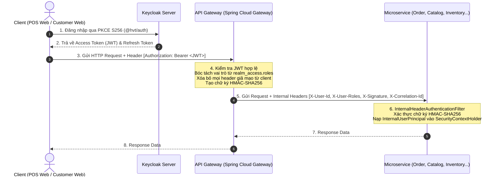

# Security Skill (Hương Vân Trà Architecture)

Tài liệu hướng dẫn toàn diện về kiến trúc bảo mật, luồng xác thực (Authentication), phân quyền (Authorization) và cơ chế giao tiếp tin cậy giữa các Microservices trong hệ thống **Hương Vân Trà**.

---

## 1. Mô hình kiến trúc Bảo mật 4 lớp

Hệ thống triển khai mô hình Zero-Trust giữa Internet và Backend, kết hợp ký số nội bộ (Internal HMAC Signature) giữa API Gateway và các Microservices:



---

## 2. Chi tiết các thành phần cốt lõi

### A. Frontend Authentication (`@hvt/auth`)
- Sử dụng chuẩn OAuth2 / OIDC với flow Authorization Code kèm PKCE (S256).
- Quản lý token duy nhất thông qua `@hvt/auth`.
- **Quy tắc an toàn:**
  - Không tự ý lưu trữ Access Token dạng plain text trong `localStorage`.
  - Không viết lại logic refresh-token bên ngoài package `@hvt/auth`.
  - Không đưa secret key vào các biến môi trường frontend (`.env` chỉ chứa `VITE_KEYCLOAK_URL`, `VITE_KEYCLOAK_REALM`, `VITE_KEYCLOAK_CLIENT_ID`).

### B. API Gateway (`infra/Api-Gateway`)
- **File cấu hình:** [`GatewaySecurityConfig.java`](file:///Users/nguyenan/Documents/Spring%20boot/Huong-Van-Tra-/infra/Api-Gateway/src/main/java/org/hvtra/apigateway/config/GatewaySecurityConfig.java) & [`InternalUserContextRelayFilter.java`](file:///Users/nguyenan/Documents/Spring%20boot/Huong-Van-Tra-/infra/Api-Gateway/src/main/java/org/hvtra/apigateway/filter/InternalUserContextRelayFilter.java).
- **Cơ chế hoạt động:**
  1. Kiểm tra JWT của Keycloak ở tầng WebFlux.
  2. Bóc tách danh sách quyền từ `jwt.getClaimAsMap("realm_access").get("roles")`.
  3. Lọc và xóa các header do client gửi lên nhằm chống tấn công Header Injection (`X-User-Id`, `X-User-Roles`, `X-Signature`, `X-Correlation-Id`).
  4. Sử dụng khóa bí mật `${security.internal.header-secret}` để ký số HMAC-SHA256 trên chuỗi dữ liệu kết hợp (`userId\nroles\ncorrelationId\nauthorization`).
  5. Đính kèm các header nội bộ trước khi forward tới downstream microservices.

### C. Downstream Microservices (`common/Common-Service`)
- Mọi microservice đều kế thừa [`BaseSecurityConfig`](file:///Users/nguyenan/Documents/Spring%20boot/Huong-Van-Tra-/common/Common-Service/src/main/java/org/hvtra/commonservice/config/BaseSecurityConfig.java) và kích hoạt [`InternalHeaderAuthenticationFilter`](file:///Users/nguyenan/Documents/Spring%20boot/Huong-Van-Tra-/common/Common-Service/src/main/java/org/hvtra/commonservice/config/InternalHeaderAuthenticationFilter.java).
- **Xác thực chữ ký:** Filter tính toán lại HMAC-SHA256 và so sánh bằng thuật toán **Constant-Time Comparison** (`constantTimeEquals`) để chống tấn công Timing Attack.
- **Nạp Principal:** Khi chữ ký hợp lệ, filter tự động tạo đối tượng `InternalUserPrincipal` và nạp vào Spring `SecurityContextHolder`.

---

## 3. Truy xuất thông tin người dùng trong mã nguồn

Sử dụng tiện ích [`SecurityUtils`](file:///Users/nguyenan/Documents/Spring%20boot/Huong-Van-Tra-/common/Common-Service/src/main/java/org/hvtra/commonservice/utils/SecurityUtils.java) trong `Common-Service`:

```java
import org.hvtra.commonservice.utils.SecurityUtils;
import org.hvtra.commonservice.domain.entity.InternalUserPrincipal;

// Lấy ID người dùng hiện tại (UUID/String từ Keycloak)
String userId = SecurityUtils.currentUserId();

// Lấy danh sách Roles hiện tại
Set<String> roles = SecurityUtils.currentRoles();

// Kiểm tra quyền hạn
if (SecurityUtils.isAdmin()) {
    // Logic dành cho Admin
}

if (SecurityUtils.hasRole("STORE_MANAGER")) {
    // Logic dành cho Cửa hàng trưởng
}

// Lấy Correlation ID phục vụ log tracing
String correlationId = SecurityUtils.currentCorrelationId();
```

---

## 4. Danh sách các Public Matchers (Endpoints công khai)

Các endpoint sau được cấu hình bỏ qua xác thực nội bộ:
- Endpoint giám sát sức khỏe: `/actuator/**`, `/actuator/health`
- Tài liệu API: `/v3/api-docs/**`, `/swagger-ui/**`, `/swagger-ui.html`
- API công khai dành cho khách hàng: `/api/*/public/**`
- Webhook cổng thanh toán: `/api/payments/webhooks/**`
- Callback giải phóng tồn kho: `/api/inventory/reservations/release-order`

---

## 5. Security Checklist khi lập trình và Review

- [ ] **Chống IDOR (Insecure Direct Object Reference):** Không tin tưởng client gửi `userId` hoặc `tenantId` trong request body. Luôn lấy `userId` từ `SecurityUtils.currentUserId()` để kiểm tra quyền sở hữu bản ghi.
- [ ] **Chống SQL Injection:** Sử dụng Spring Data JPA Repository hoặc JPQL với Parameter Binding (`:paramName`), tuyệt đối không ghép chuỗi SQL thuần.
- [ ] **Kiểm tra Bean Validation:** Mọi DTO nhận vào ở Controller bắt buộc có `@Valid` và các annotation kiểm tra dữ liệu (`@NotNull`, `@NotBlank`, `@Size`, `@Min`, `@Max`).
- [ ] **Chống rò rỉ dữ liệu nhạy cảm (Data Exposure):**
  - Không bao giờ trả về Entity JPA trực tiếp ở Controller (luôn map sang DTO Response).
  - Không log thông tin mật (Password, Secret Key, Token, Số thẻ ngân hàng).
- [ ] **Feign Client Internal Relay:** Khi gọi liên service qua Feign Client, đảm bảo FeignConfig đã cấu hình chuyển tiếp các internal headers hoặc cấu hình xác thực nội bộ hợp lệ.
